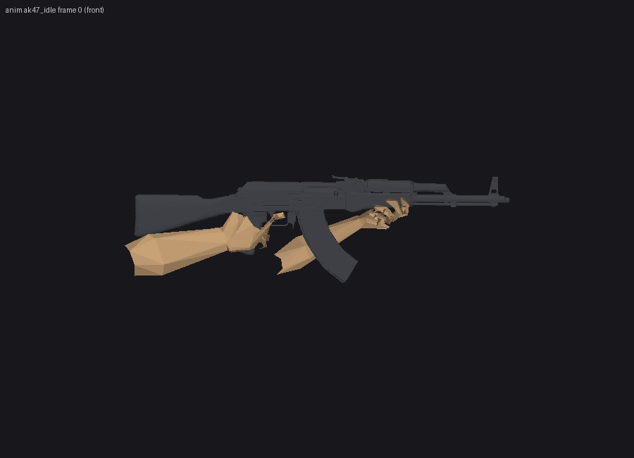
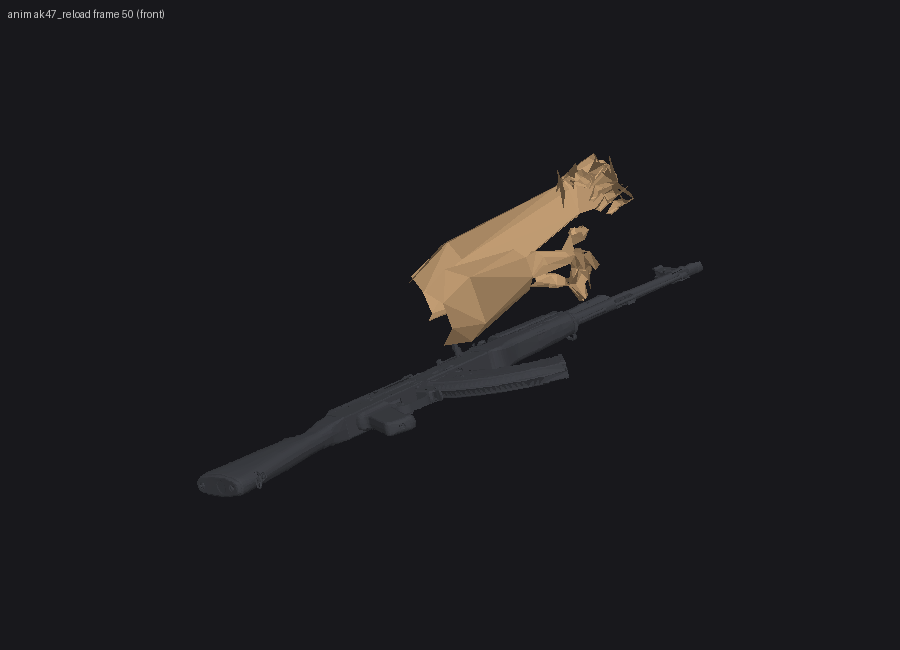

# asd — Viewmodels de CS2 para Counter-Strike clásico (GoldSrc / Xash3D FWGS)

Port de los viewmodels de Counter-Strike 2 (packs `CS2GO.Pack.*` de *archi*) al
formato **GoldSrc** para usarlos como reemplazo directo de los viewmodels de
Counter-Strike 1.x en **Xash3D FWGS** (también vale en CS 1.6 clásico).

**Piloto: AK-47** (`v_ak47.mdl`) — malla y animaciones de carga CS2 (idle, draw,
recarga, 3 disparos), texturas recodificadas, brazos del modelo clásico
re-apuntados a los huesos CS2, sonidos CS2 convertidos a 22050 Hz 16-bit mono.
Más armas por venir con el mismo pipeline.

## Instalación

Ver `docs/INSTALL.md` — o simplemente copia `game/cstrike/` encima de tu
`cstrike/` (con backup de `v_ak47.mdl` y `ak47-1/2.wav`). También hay un ZIP
instalable: `dist/ak47-cs2-goldsrc.zip`.

## Compilar el modelo tú mismo

```bash
sudo apt install python3 python3-venv build-essential git
bash tools/setup_tools.sh
tools/vendor/venv/bin/python tools/cstrike_port.py build ak47
tools/vendor/venv/bin/python tools/cstrike_port.py preview ak47   # PNGs de verificación
```

El pipeline completo (formatos, decisiones de diseño, retargeting de animaciones,
trasplante de brazos) está documentado en **`docs/PIPELINE.md`**.

## Estructura

| Ruta | Contenido |
|---|---|
| `game/cstrike/` | Archivos listos para instalar (modelo + sonidos) |
| `dist/ak47-cs2-goldsrc.zip` | ZIP instalable con `INSTALL.md` y `NOTICE.md` |
| `tools/cstrike_port.py` | Pipeline completo: extracción → SMD → QC → `.mdl` |
| `tools/anim_decoder.py` | Decodificador FRAMEANIM de `.ani` de Source 1 |
| `tools/setup_tools.sh` | Clonado/compilación de las herramientas (SourceIO, studiomdl-sven, halflife-tools) |
| `docs/` | PIPELINE.md, INSTALL.md, NOTICE.md |

## Vista previa (bind y animaciones, rasterizado headless)

| Pose | Imagen |
|---|---|
| Bind (referencia) | `docs/preview_bind.png` |
| idle f0 | `docs/preview_idle.png` |
| draw f8 | `docs/preview_draw.png` |
| reload f50 | `docs/preview_reload.png` |




## Avisos

Contenido derivado de assets de Valve (CS 1.x, CS2): **solo para uso personal,
prohibida su redistribución pública**. Detalles en `docs/NOTICE.md`.
